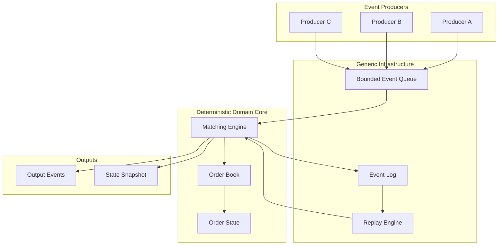

# Component Diagram



## Responsibilities

### Event Producers

Generate input events. Producers may execute concurrently.

### Bounded Event Queue

Provides the concurrency boundary between producers and the deterministic processing core.

The queue transports events but has no knowledge of order-book rules.

### Matching Engine

The single logical owner of domain processing.

It consumes events, updates the order book, and produces output events.

### Order Book

Maintains active orders and implements price-time priority.

### Order State

Represents the lifecycle of individual orders.

### Event Log

Records the ordered input event stream for reproducibility and replay.

### Replay Engine

Feeds previously recorded events back into the matching engine.

### State Snapshot

Represents deterministic engine state at a particular point in processing.

## Dependency rule

The important dependency direction is:

```text
Application
    |
    v
Infrastructure
    |
    v
Matching Engine
    |
    v
Order Book
```

The order book must not depend on the queue, event log, filesystem, or network.

The queue must not depend on order-book concepts.

The replay engine feeds events into the same matching engine used for normal processing.

