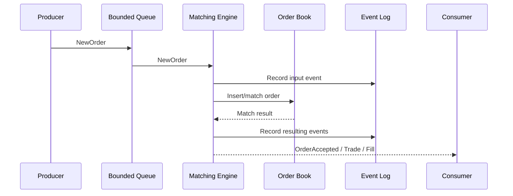
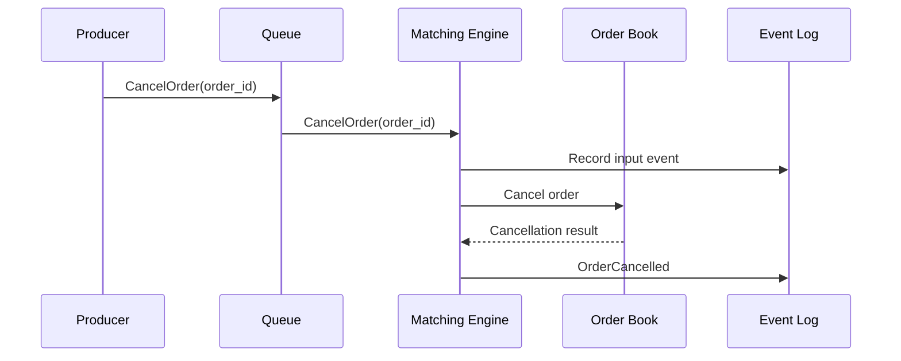
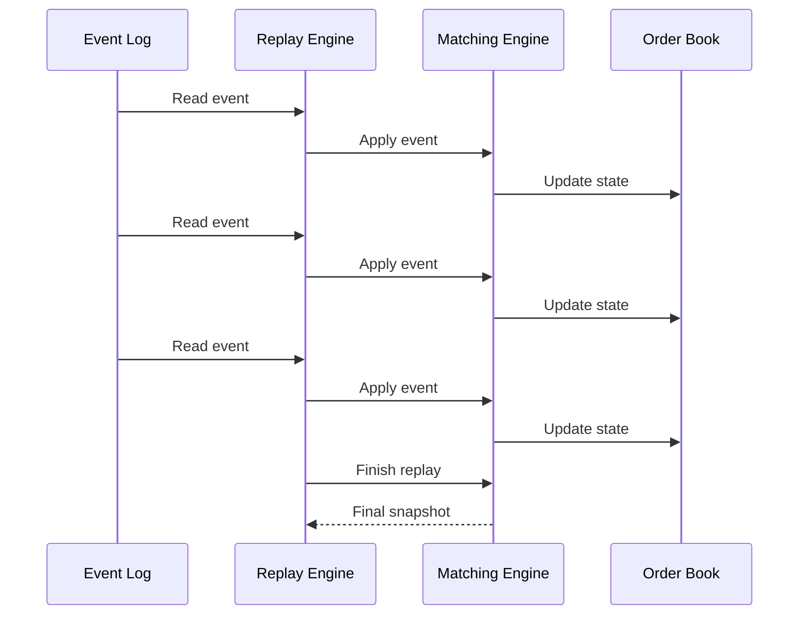

# Message Flow

## 1. Normal order submission

The normal processing path is:



The producer does not directly modify the order book.

The queue is the concurrency boundary.

The matching engine processes the event sequentially.

---

## 2. Example matching flow

Initial state:

```text
BUY  100 @ 100
```

Incoming event:

```text
SELL 30 @ 99
```

Processing:

```text
Producer
   |
   | NewOrder(SELL, 30, 99)
   v
Queue
   |
   v
Matching Engine
   |
   | Find best compatible bid
   v
Order Book
   |
   | BUY 100 @ 100
   |
   v
Match
   |
   +--> Trade 30 @ 100
   |
   +--> Buy remaining: 70
   |
   +--> Sell remaining: 0
```

Result:

```text
TradeExecuted
    quantity = 30

BUY order
    remaining = 70

SELL order
    status = FILLED
```

---

## 3. Partial-fill flow

Suppose:

```text
BUY 100 @ 100
```

and:

```text
SELL 40 @ 99
```

The matching engine produces:

```text
TradeExecuted(40)
```

and changes the order state:

```text
BUY:
    quantity = 100
    filled = 40
    remaining = 60
    status = PARTIALLY_FILLED
```

The remaining order stays in the order book.

---

## 4. Multiple price levels

Suppose the book contains:

```text
BUY 50  @ 101
BUY 100 @ 100
BUY 200 @ 99
```

Incoming order:

```text
SELL 120 @ 99
```

The engine processes the best prices first:

```text
SELL 120
    |
    +--> BUY 50 @ 101
    |
    +--> BUY 70 @ 100
```

Output:

```text
TradeExecuted(50 @ 101)
TradeExecuted(70 @ 100)
```

Remaining order:

```text
BUY 30 @ 100
BUY 200 @ 99
```

The exact trade-price rule should be documented as part of the matching policy.

---

## 5. Cancellation flow



If the order exists and is cancellable:

```text
CancelOrder
     |
     v
Order Book
     |
     v
OrderCancelled
```

If the order does not exist:

```text
CancelOrder
     |
     v
Order Book
     |
     v
OrderRejected
```

---

## 6. Deterministic replay

Replay uses exactly the same processing path as normal execution.



The important property is:

```text
Initial state
    +
Event 1
    +
Event 2
    +
...
    +
Event N
    =
Deterministic final state
```

Running the same replay again must produce the same result.

---

## 7. Concurrent input, deterministic processing

Multiple producers may operate concurrently:

```text
             Producer A
                  |
             Producer B
                  |
             Producer C
                  |
                  v
          +---------------+
          | Bounded Queue |
          +-------+-------+
                  |
                  v
          +---------------+
          | Matching      |
          | Engine        |
          +-------+-------+
                  |
                  v
             Order Book
```

The matching engine itself remains single-threaded.

This is intentional.

Concurrency is used for event ingestion rather than for simultaneous mutation of the order book.

The design therefore separates:

```text
Concurrency problem
        |
        v
     Queue

Domain correctness
        |
        v
Matching Engine + Order Book
```

This makes the core easier to test, reason about, replay, and profile.
